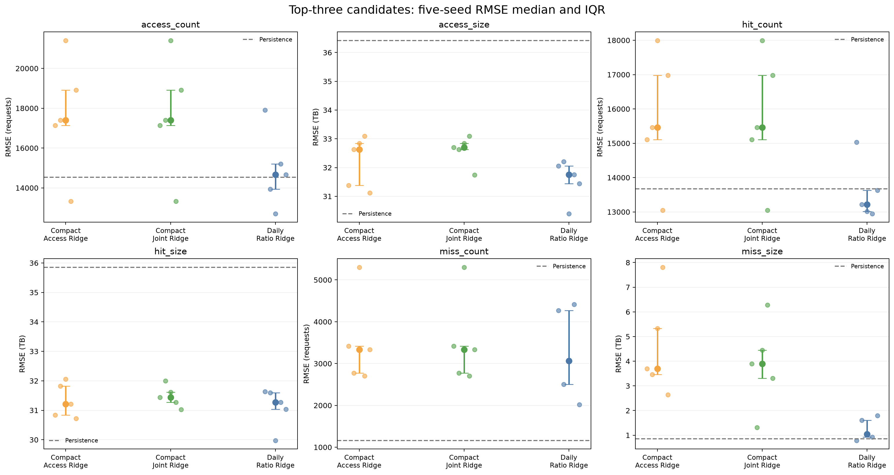

# XCache Time Series Forecasting with Structured TCNs

Research notebooks for forecasting regional scientific-data cache traffic with Temporal Convolutional Networks (TCNs). The main task is **one-day-ahead forecasting of six SoCal XCache traffic variables**, with experiments on physical consistency, traffic regime changes, extreme events, intraday features, and residual Ridge correction.

The central constraint is:

```text
access_count = hit_count + miss_count
access_size  = hit_size  + miss_size
```

A hard Structured TCN predicts access volume and hit ratios, then reconstructs hits and misses. This produces non-negative forecasts that satisfy both identities by construction. Direct-output and direct-residual models are included as comparison methods; they do not enforce these identities.

## Start here

- [Project summary](PROJECT_SUMMARY.md): research progression and findings through Week 8.
- [Week 10 notebook](week10/Sammy_TCN_261111.ipynb): latest residual-correction and five-seed experiments.
- [Latest result tables and figures](week10/results/whole_range_residual_ridge/): saved outputs, configurations, checkpoints, and calibration selections.

The notebooks contain their model implementations and saved outputs. You can inspect the results on GitHub without retraining.

## Data and forecasting task

The repository includes pickled pandas time series at daily and hourly resolution for SoCal, Chicago, and Boston. Exploration covers all three sites; the forecasting experiments focus on **SoCal, 2020-05-31 through 2024-03-31: 1,401 daily observations**.

| Variable | Meaning | Evaluation unit |
|---|---|---|
| `access_count` | Total cache requests | Requests |
| `access_size` | Total requested data volume | TB |
| `hit_count` | Requests served from the cache | Requests |
| `hit_size` | Data volume served from the cache | TB |
| `miss_count` | Requests not served from the cache | Requests |
| `miss_size` | Data volume associated with cache misses | TB |

Source size values are in bytes. The notebooks convert them to decimal terabytes using `1 TB = 10^12 bytes`. Files such as `socal-2006-2403-daily-ml` have no extension but are pandas pickle files. See the [original data notes](xcache-ts/xcache-ts-readme.txt) for naming conventions.

The main data directory is `xcache-ts-df/`. The original distribution, including another copy of the data and a reference Keras/LSTM notebook, is preserved under `xcache-ts/`. The original `.tar.gz` archives are also included.

## Models and evaluation

The standard later-stage TCN uses five residual blocks, 64 channels per block, kernel size 3, and dilations of 1, 2, 4, 8, and 16. With two causal convolutions per block, its receptive field is 125 days. A shorter supplied lookback still limits the available history.

For each of count and size, the hard structured decoder uses predicted access `A` and a bounded hit ratio `r`:

```text
H = A * r
M = A * (1 - r)
```

Experiments compare persistence (tomorrow equals today), direct TCN, hard Structured TCN, LSTM, soft identity penalties, logit-ratio outputs, trend features, and hourly-derived intraday features. Week 10 adds Ridge corrections to hit ratio, hit size, access size, or access and ratio jointly.

Evaluation uses chronological splits, RMSE in original units, and identity error. Event analyses also report peak/spike errors, precision, recall, and bias. Thresholds are derived from training data; consult each notebook for its exact event definition and split. The latest event evaluation defines peaks by a positive level at or above the training 90th percentile, and spikes by a positive one-day increase at or above the training 90th percentile of changes.

## Experiment guide

| Folder | Notebook | Main question |
|---|---|---|
| `week1/` | [Yingxin_TCN_260909.ipynb](week1/Yingxin_TCN_260909.ipynb) | Data exploration, regional patterns, and access/hit/miss identities |
| `week2/` | [Yingxin_TCN_260916.ipynb](week2/Yingxin_TCN_260916.ipynb) | Initial three-block Structured TCN baseline |
| `week3/` | [Yingxin_TCN_260923.ipynb](week3/Yingxin_TCN_260923.ipynb) | Architecture, receptive field, lookback, direct/structured models, and LSTM |
| `week4/` | [Sammy_TCN_260930.ipynb](week4/Sammy_TCN_260930.ipynb) | Post-change-point forecasting and calendar-feature comparisons |
| `week5/` | [Sammy_TCN_261007.ipynb](week5/Sammy_TCN_261007.ipynb) | Identity error, miss-error propagation, and constraint tradeoffs |
| `week6/` | [Sammy_TCN_261014.ipynb](week6/Sammy_TCN_261014.ipynb) | Normal days, peaks, spikes, and traffic regimes |
| `week7/` | [Sammy_TCN_261021.ipynb](week7/Sammy_TCN_261021.ipynb) | Causal trend features and five-seed regime robustness |
| `week8/` | [Sammy_TCN_261028.ipynb](week8/Sammy_TCN_261028.ipynb) | Longer lookbacks and hourly intraday summaries |
| `week10/` | [Sammy_TCN_261111.ipynb](week10/Sammy_TCN_261111.ipynb) | Residual Ridge correction, compact intraday features, and five-seed comparisons |

Folder numbering follows the existing research milestones; there is no Week 9 folder in this snapshot. Most experiment outputs live in the corresponding `week*/results/` directory. The root `results/` directory also contains an earlier saved ablation table.

## Selected results

### Post-change-point baseline: Week 4

On the late-regime experiment beginning in July 2022, the 14-day hard Structured TCN improved RMSE over persistence for five of the six variables:

| Variable | Structured TCN RMSE | Persistence RMSE |
|---|---:|---:|
| `access_count` | 15,799.9 | 19,116.8 |
| `access_size` | 40.535 TB | 47.845 TB |
| `hit_count` | 14,847.8 | 17,914.6 |
| `hit_size` | 40.040 TB | 47.000 TB |
| `miss_count` | 1,261.5 | 1,482.9 |
| `miss_size` | 1.722 TB | 1.156 TB |

Source: [saved Week 4 RMSE table](week4/results/post_change_point_structured_14day_5block_64channel/test_rmse.csv). Physical consistency does not guarantee the best error for every target: `miss_size` remained worse than persistence in this experiment.

### Latest experiment: Week 10

Week 10 uses the complete SoCal period with a separate calibration segment for fitting residual models:

| Segment | Dates | Raw days |
|---|---|---:|
| TCN training | 2020-05-31 – 2022-09-17 | 840 |
| TCN validation | 2022-09-18 – 2023-02-04 | 140 |
| Ridge calibration | 2023-02-05 – 2023-09-02 | 210 |
| Test | 2023-09-03 – 2024-03-31 | 211 |

TCN checkpoints are selected by validation `hit_size` RMSE. Ridge regularization is selected with three chronological folds inside calibration. The compact intraday model adds six descriptors: hourly high/mean, low/mean, and range/mean for historical access size and hit size, using complete prior days only.

The following summarizes `hit_size` test RMSE across seeds **42, 7, 21, 84, and 2026**. Lower RMSE is better; IQR is the difference between the 75th and 25th percentiles across runs.

| Model | Median RMSE (TB) | IQR (TB) |
|---|---:|---:|
| Persistence, deterministic | 35.852 | — |
| Daily Structured TCN | 31.394 | 0.495 |
| Daily Structured TCN + ratio Ridge | 31.272 | 0.563 |
| Compact intraday Structured TCN | 32.351 | 0.528 |
| Compact intraday TCN + access Ridge | 31.216 | 0.988 |
| Compact intraday TCN + joint Ridge | 31.434 | 0.338 |

Source: [six-variable median/IQR table](week10/results/whole_range_residual_ridge/top3_seed_robustness/six_variable_rmse_median_iqr.csv). The full tables include all six variables; improvements in hit size can coincide with worse count or miss-size forecasts.

**Interpretation:** these are exploratory robustness results. The three corrected candidates were shortlisted using the seed-42 test ranking on a test period reused from earlier experiments. Repeating seeds measures initialization sensitivity, but does not provide an independent final test or establish robustness to a new time period.

The separate validation/calibration-selected seed-42 pipeline chose daily inputs plus **direct Ridge**, with hit-size test RMSE of **31.737 TB**. Direct Ridge does not enforce the identity. See the [locked selection](week10/results/whole_range_residual_ridge/locked_pipeline_selection.json) and [full comparison](week10/results/whole_range_residual_ridge/all_models_test_metrics.csv). Do not treat the test-ranked shortlist as the validation-selected winner.



Week 4 and Week 10 use different training/evaluation protocols. Their RMSE values should not be compared as a controlled before/after improvement.

## Run locally

Use **Python 3.11**. CPU execution is supported; notebooks use CUDA when available. The dependency file keeps NumPy below version 2 for compatibility with PyTorch 2.2.2 and the NumPy bridge used in earlier notebooks.

```bash
git clone https://github.com/sammydyx/xCache_Time_Series_TCN_Forecasting.git
cd xCache_Time_Series_TCN_Forecasting
python3.11 -m venv .venv
source .venv/bin/activate
python -m pip install -r requirements.txt
python -m ipykernel install --user --name xcache-tcn --display-name "Python (xcache-tcn)"
jupyter lab
```

Open a weekly notebook and select **Python (xcache-tcn)**. Run it from its own week directory; some early notebooks resolve data using `../xcache-ts-df`. The bundled data are already extracted, so downloading or unpacking archives is not required.

For the latest notebook, a command-line runner uses the active Python interpreter and saves cell outputs as execution progresses:

```bash
# Execute the complete Week 10 notebook.
python week10/run_notebook.py

# Regenerate the section 8 figures from existing CSVs, without model training.
python week10/run_notebook.py --plots-only

# Resume the five-seed robustness section using saved intermediate results.
python week10/run_notebook.py --robustness-only
```

The full run includes multiple training and calibration experiments. It can reuse compatible cached TCN checkpoints; see `USE_CACHED_TCN` in the notebook. The two partial-run modes expect the included result files to be present. Executing the runner updates the notebook outputs and result files.

The original `xcache-ts/ML-LSTM-Keras.ipynb` is reference material and requires its own TensorFlow/Keras environment; these optional dependencies are not part of the PyTorch requirements.

## Repository layout

```text
.
├── README.md
├── PROJECT_SUMMARY.md                 # Detailed summary through Week 8
├── requirements.txt                  # Core PyTorch/notebook dependencies
├── week1/ ... week8/                  # Research notebooks and saved experiments
├── week10/
│   ├── Sammy_TCN_261111.ipynb          # Latest self-contained implementation
│   ├── run_notebook.py                # Full and partial notebook execution
│   └── results/whole_range_residual_ridge/
│       ├── daily_base/
│       ├── compact_intraday/
│       ├── access_joint_extension/
│       └── top3_seed_robustness/
├── results/                          # Earlier root-level ablation output
├── xcache-ts-df/                      # Extracted daily/hourly pandas datasets
├── xcache-ts/                         # Original data distribution and reference notebook
└── xcache-ts-2024*.tar.gz             # Original source archives
```

Result folders contain CSV forecasts and metrics, PNG plots, JSON configurations, PyTorch checkpoints, and fitted Ridge artifacts where available. Local virtual environments, Jupyter checkpoints, Python bytecode, and runtime caches are excluded from version control.

## Limitations and reproducibility

- Findings depend on the traffic regime, lookback, feature set, and objective. No model wins across all six targets and event metrics.
- Extreme peaks and spikes remain difficult; overall RMSE can conceal underprediction on high-traffic days.
- Five seeds quantify initialization variability on one split, not future-period generalization. Parts of the experimental comparison use a reused test benchmark and a test-informed shortlist.
- Some comparisons are single-seed experiments. Check each notebook before generalizing a reported improvement.
- Most modeling code is notebook-based rather than a packaged training API. Data checks and saved experiment outputs are included, but there is no standalone automated test suite.
- Saved Week 10 results record their environment in [environment.json](week10/results/whole_range_residual_ridge/environment.json). That run used a different NumPy/pandas stack from the compatibility requirements above; exact numerical reproduction can also depend on library versions, hardware, and checkpoint reuse.

Author: **Yingxin Deng**.
